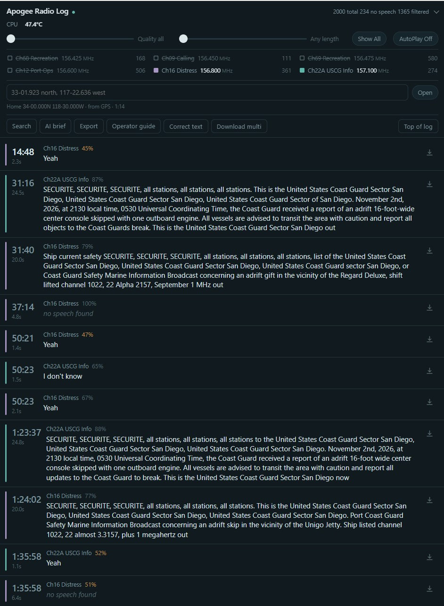
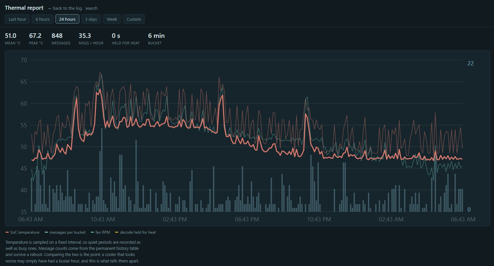
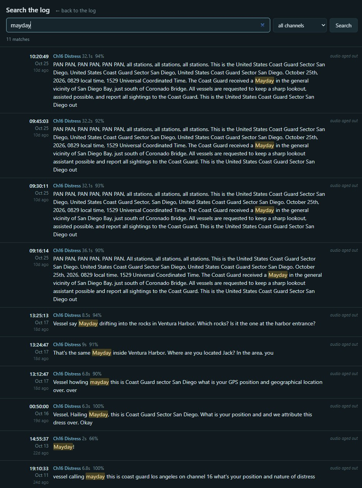
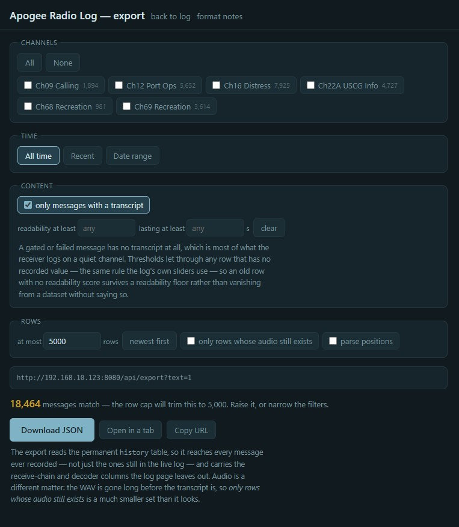
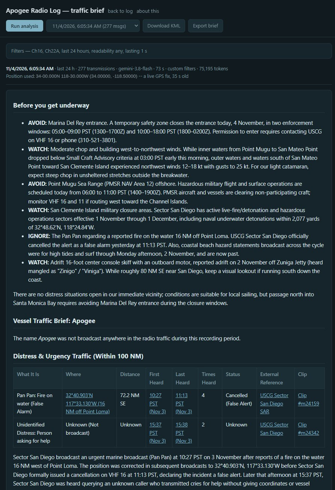

# Radio Log

A multi-channel VHF watchkeeper for a Raspberry Pi 5 and a $40 SDR dongle. It
listens to six or more channels **at once**, records every transmission as a
separate audio file, transcribes it, and serves a phone-friendly log you can
read from the cockpit or anywhere on your network.



## Why not a scanner?

A scanner stops on one channel at a time. While it is listening to the Coast
Guard, it is deaf to the harbour calling you on 12.

This receives the entire 2 MHz band continuously and splits it into channels in
software, so nothing is missed while something else is talking. Every channel
is monitored simultaneously, every transmission is captured, and the log tells
you what happened while you were away from the radio.

It is a **receiver only**. It cannot transmit, and it is not a substitute for
keeping a watch on 16.

## What you get

- **Every transmission recorded** and playable from the browser. Download one
  clip, or tick several and take them away as a single zip with the audio and
  the transcript side by side.
- **Two-pass transcription**, running locally — no internet, no cloud, no
  account. Parakeet reads everything; `medium.en` re-reads what Parakeet
  struggled with. See [transcription](#transcription-two-passes).
- **Full-text search** across every transcript ever recorded, including
  messages whose audio has long since been evicted.
- **Hand corrections.** When the decoder mangles something that matters, type
  what was actually said. The original is kept alongside it, never overwritten.
- **A JSON export** with channel, time-window, age, quality and duration
  filters, for analysis elsewhere — with a form over it so you do not have to
  write query strings on a phone.
- **A readability score** (0–100) per message, derived from the spectral
  flatness of the audio, with a slider to hide the noise-only captures.
- **Distress flagging** on keywords, so a mayday stands out in the log.
- **Positions plotted.** Coordinates read out in a transmission are parsed and
  shown as map pins, filtered against where the receiver actually is — which it
  learns from a Signal K server if there is one, and falls back to the config.
  There is a box at the top of the log for pasting a position you heard but the
  parser missed.
- **Hallucination filtering.** Whisper was trained on scraped subtitles and
  happily emits `[engine revving]`, `Thanks for watching!` and endless repeats
  of the last phrase on noisy input. Six classes of that are stripped without
  discarding the real words around them.
- **A thermal report**, because on a Pi this is a thermal problem as much as a
  radio one. See below.
- **Works offline.** The page has no webfonts and no CDN links, because a boat
  at anchor has no connectivity. One optional feature is the exception, and it
  says so loudly: see [the AI brief](#the-ai-brief-optional-and-not-offline).

Two bands are supported and behave quite differently:

| Band | Frequencies | Mode | Typical traffic |
|---|---|---|---|
| Marine VHF | 156–158 MHz | Narrowband FM | Vessels, harbour control, Coast Guard |
| Aviation | 118–137 MHz | AM | Air traffic control |

---

## Hardware

Everything below is what the system was developed and measured on. Approximate
US prices as of late 2026.

### What you need

| Part | What to buy | ~Price | Notes |
|---|---|---|---|
| **Computer** | Raspberry Pi 5, 8 GB | $80 | 16 GB was used here but is not needed. **4 GB is too small** once the speech models are loaded. |
| **Receiver** | RTL-SDR Blog V4 | $40 | Get this exact one. The 1 PPM TCXO means you can tune to a channel and stay there; cheap generic dongles drift enough to walk off a 12.5 kHz channel as they warm up. Comes with a dipole antenna kit. |
| **Cooling** | Active cooler **and** a metal case | $25 | **Not optional** — see below. |
| **Storage** | 32 GB+ A2 microSD | $12 | Or boot from an NVMe HAT if you have one. Recordings are kept in RAM to spare the card. |
| **Power** | Official 27 W USB-C supply | $14 | An underpowered supply causes throttling that looks exactly like overheating. |
| **Antenna** | A real marine VHF antenna | $30–150 | The single biggest factor in how well any of this works. |
| **T/R switch** | MFJ-1708B-SDR | $100 | **Only if you share an antenna with a transmitter** — and on a boat you almost certainly do. See below. |

Rough total: **$200–300**, or **$300–400** if the antenna is shared with the
vessel's VHF.

### On cooling — read this one

The transcriber pins cores for as long as there is a backlog, and a bare Pi 5
doing that will hit its 80 °C throttle point and stay there. Throttling slows
the DSP as well as the transcriber, and a DSP that falls behind real time drops
audio chunks — you lose transmissions.

How much it matters was measured by swapping the cooling and changing nothing
else. The original setup ran **51.2 °C above ambient** under transcription
load. The replacement ran **24.3 °C above ambient** — in a *hotter* cabin on a
hotter day. That is the difference between a governor that is constantly
intervening and one that never fires.

The software includes a thermal governor that pauses transcription above a
configurable temperature, but it is a backstop, not a substitute for a
heatsink, and it is easy to tune badly. Two failure modes were found the hard
way and are documented in `docs.html` §4.15:

- **Too patient.** A long `thermal_max_wait_s` against a resume threshold that
  a hot cabin never reaches means every message waits the full timeout and then
  decodes anyway. Throughput collapses below the arrival rate and the queue
  never recovers.
- **Governor disabled.** The SoC pins at 84–87 °C, hard-throttles, and starves
  the DSP — at which point the squelch starts opening on noise and the message
  rate *rises* while the content disappears.

`/report` plots SoC temperature against messages per bucket on one axis, which
is what separates "this cooler is worse" from "that hour was busier".



It is on by default. Set `thermal_report = false` under `[web]` to hide the
page and its header link.

### On the antenna — read this one too

This is not the usual hand-waving about antennas. It was measured.

Transcripts recorded eleven miles inland with the supplied dipole were largely
unusable **regardless of which speech model ran**. The same code, unchanged, at
a dock with the same dipole produced coherent Coast Guard and harbour traffic.
Moving the antenna moved the result from unusable to good; no model choice came
close to that.

In order of what actually helps:

1. **Height and a clear view of the water.** VHF is line of sight.
2. **Outside, not inside.** A cabin, and especially a metal or foil-lined one,
   costs you more than any software setting will win back.
3. **A proper marine antenna** on decent coax, over the supplied dipole.
4. Only then, anything in this repository.

If your transcripts are poor, the answer is almost never in the config file.

### Sharing the antenna with the boat's VHF — read this before you plug anything in

The receiver here is not on an antenna of its own. It shares the masthead
antenna with the vessel's VHF transceiver through an **MFJ-1708B-SDR**
RF-sensing T/R switch: antenna into the switch, transceiver on the XCVR port,
dongle on the SDR REC port.

> **Without this, the first transmission ends the dongle.** An RTL-SDR front
> end is built for microvolts and tolerates a few milliwatts. A fixed-mount
> marine VHF puts out up to 25 W — about seven orders of magnitude more, down
> a few metres of coax that attenuate almost none of it. No software setting
> protects against that, and "I just won't transmit while it's running" is not
> a plan, because anyone aboard can pick up the handset.

The switch idles with the antenna on the SDR, transfers it to the transceiver
when it senses RF, and isolates the SDR input until the carrier drops. What
matters for this use:

- **Rated to 200 W**, so a 25 W marine set is well inside it. The manual is
  explicit that it must not be used above 200 W.
- **Good SWR through 450 MHz**, so 156–158 MHz is comfortably in range.
- **Receive delay is adjustable**, roughly 40–50 ms to 2–4 seconds. Keep it
  near the short end: that delay is time this receiver is deaf on *every*
  channel.
- **A CTRL input** will key the switch from the transceiver's PTT line
  directly, if you would rather not depend on RF sensing.
- **Remove JP2.** It improves receive-path loss at VHF and UHF, which is the
  only band this system uses.
- **Never transmit into the SDR REC port.** It is an input only.

The cost of the arrangement is a blind spot, and it is worth understanding
before you trust the log: see [limitations](#honest-limitations).

### A note on tuner gain

Counter-intuitively, the gain that works is low — around 15 dB on the R828D,
not the 30 or 40 the tuner will happily give you. Its mixer generates
third-order intermodulation products from strong nearby signals, and at high
gain these appear as a comb of *real-sounding voice* on frequencies where
nothing is transmitting. It is not channel bleed (adjacent-channel rejection is
67 dB) and it is not ADC clipping (peaks sat 45 dB below full scale) — it is
the front end.

Going lower than necessary costs you, though: across 16.6, 15.7 and 14.4 dB
the measured noise floor did not move at all, which means the receiver is
ADC-limited rather than noise-limited there and every further step down is pure
loss of sensitivity for no reduction in noise. `docs.html` §4.6.1 has the
measurements.

### What *not* to buy

**The Raspberry Pi AI HAT+ 2 (Hailo-10H NPU) — $110.** It was bought,
installed, benchmarked against a hand-transcribed ground-truth corpus, and
rejected. `base` is the largest Whisper variant the Hailo tooling offers, and
both `tiny` variants return punctuation soup because their decoder architecture
is mishandled by the current runtime. The NPU does run about 28 °C cooler and
leaves the CPU free, but it cannot approach the CPU models on noisy radio
audio, and accuracy is the whole point.

---

## Transcription: two passes

Until late October this ran `faster-whisper` alone and spent most of its
thermal budget doing it. It now runs two engines in sequence, configured in
`[radio]`:

**The primary decoder** is Parakeet (`nemo-parakeet-tdt-0.6b-v2`) through
`onnx-asr`. It sees every clip. It is roughly an order of magnitude faster than
`faster-whisper` on the same board, which is what makes keeping up with six
channels possible at all — and what made it affordable to stop filtering clips
by readability before decoding them.

**The second pass** is `medium.en`, loaded on demand, and it re-reads only what
the primary struggled with: clips the primary heard nothing in, and clips below
the readability floor. In practice that is about a fifth of traffic.

Three things were learned bringing Parakeet in, and all three are settings you
may need:

- **It drops the opening of a transmission when either edge is abrupt** — the
  proword and the station ID, which is to say the two most valuable parts.
  Trimming and padding *both* ends (`edge_head_trim_ms`, `edge_tail_trim_ms`)
  recovered them; treating the front alone did not.
- **Encoder activations are quadratic in clip length.** A 373-second broadcast
  fed in whole cost 3.2 GB and was OOM-killed on an 8 GB board. Clips are split
  at `primary_chunk_s`, at the quietest point within two seconds of the
  boundary so a spoken coordinate is not cut in half. **Do not raise that
  casually.**
- **Sparse decodes are detectable.** Good output runs 10–17 characters per
  second; the known failures sat at 3.2. Anything long enough and sparse enough
  is decoded a second time against the raw, untreated audio.

Quantisation is set to `"none"`. `int8` is faster and measurably worse, and on
radio audio that is the wrong trade.

### Choosing a model

Sixteen configurations were benchmarked against two hand-transcribed clips: one
strong, one marginal. The full table is in `docs.html` §4.7.2. Three findings
matter more than the ranking, and they still hold:

- **The gap between models widens exactly where it matters.** On the strong
  clip `small.en` and `medium.en` were within a point of each other. On the
  marginal clip they were twenty-one points apart, and `small.en` invented a
  place name that was not said. A model comparison run only on good audio will
  tell you model choice is irrelevant. It is not.
- **Every distilled variant mangles positions.** They are fast and they are
  fluent and they will cheerfully alter a latitude. Do not use them for this.
- **No model read Sécurité or PAN PAN correctly.** The words that matter most
  are the ones least likely to survive, which is the single best argument for
  listening to the clip rather than reading the transcript.

Word error rate ranked the models almost backwards from how useful they turned
out to be here. Position yield, agreement between engines in metres, and
measured real-time factor are the numbers that decide.

To run `faster-whisper` alone, as before, set `primary_model = ""`.

---

## Installing

Assumes a fresh Raspberry Pi OS (Debian 13 "trixie") with SSH enabled.

```bash
# 1. The SDR tools (rtl_sdr is a system package, not a Python one)
sudo apt update
sudo apt install -y rtl-sdr sqlite3 python3-venv tmux

# 2. Confirm the dongle is seen. "No E4000 tuner found" is expected and
#    harmless -- the V4 has an R828D.
rtl_test -t

# 3. The Python side, in its own virtualenv
python3 -m venv ~/venv_wx
~/venv_wx/bin/pip install -r requirements.txt

# 4. The program files
cp watchkeeper.py webui.py asr_engines.py docs.html refresh.sh brief_prompt.txt ~/
cp watchkeeper.example.toml ~/watchkeeper.toml      # then edit it

# 5. Recordings in RAM, to spare the SD card
mkdir -p ~/watchkeeper/audio
echo "tmpfs $HOME/watchkeeper/audio tmpfs defaults,noatime,nosuid,size=768M,mode=0755,uid=$(id -u),gid=$(id -g),nofail 0 0" | sudo tee -a /etc/fstab
sudo systemctl daemon-reload
sudo mount ~/watchkeeper/audio
```

Size that tmpfs against `max_messages`, not against a guess: recordings measure
about **245 KB each** at 16 kHz mono, so the default 2,000-message ring needs
roughly 500 MB and 768 MB leaves headroom. `nofail` matters — without it, a
mount that fails at boot stops the Pi reaching a login prompt.

Then run it:

```bash
~/venv_wx/bin/python ~/watchkeeper.py --list-presets
~/venv_wx/bin/python ~/watchkeeper.py --preset marine   # the receiver
~/venv_wx/bin/python ~/webui.py                         # the web interface
```

Open `http://<the-pi>:8080`.

The first run downloads both speech models and calibrates the squelch — nothing
records for the first twenty seconds or so, which is normal.

### Running at boot

```bash
sudo cp systemd/watchkeeper@.service systemd/watchkeeper-web@.service /etc/systemd/system/
sudo systemctl daemon-reload
sudo systemctl enable --now watchkeeper@$USER watchkeeper-web@$USER
journalctl -u watchkeeper@$USER -f
```

The units are templated on the username, so `watchkeeper@pi` and
`watchkeeper@yourname` both work without editing paths.

> **One radio, one program.** An enabled service holds the dongle from power-on.
> `rtl_power`, `gqrx` and this program's own `--record` will all fail to open
> the device until you `sudo systemctl stop watchkeeper@$USER`.

### Optional: the nightly recycle

ONNX Runtime's CPU arena allocates and never gives memory back, so a busy board
climbs steadily over days. `nightly_recycle.py` restarts the receiver in the
small hours, but only when the log has been quiet long enough that nothing is
lost:

```cron
*/10 0-5 * * * root WATCHKEEPER_USER=pi /home/pi/venv_wx/bin/python /usr/local/bin/nightly_recycle.py
```

`--dry-run` reports the decision and changes nothing. Set `WATCHKEEPER_USER` —
under cron as root there is no login name for the script to infer.

---

## Configuring it for where you are

Everything lives in `watchkeeper.toml` — you should never need to edit the
program. Start from `watchkeeper.example.toml`, which is the live configuration
from a working installation with the identifying values replaced. Name your
station, then define the channels you care about:

```toml
[radio]
station_name = "Radio Log"    # the title of the web page

[preset.marine]
center_hz = 156762500
mode = "nfm"
channels = [
  { name = "Ch09 Calling",    freq = 156450000 },
  { name = "Ch12 Port Ops",   freq = 156600000 },
  { name = "Ch16 Distress",   freq = 156800000, distress = true },
  { name = "Ch22A USCG Info", freq = 157100000 },
  { name = "ref-a", freq = 156237500, role = "reference" },
]
```

Two rules, both checked at startup:

1. Every channel must sit within about ±800 kHz of `center_hz`. The tuner rolls
   off near the edges of the 2.048 MHz window.
2. Put `center_hz` where no channel sits — the tuner leaks a DC spike there.

**Reference channels** (`role = "reference"`) are frequencies you expect to be
permanently silent. The program measures the noise floor on them to calibrate
every squelch threshold automatically, and raises an alarm if their power
collapses — which is what a disconnected antenna looks like.

Six presets ship as examples: three marine, two SoCal aviation, and one for
weather and AIS.

### Surveying your location

Marine channel usage is intensely local. Before committing to a channel list,
look at what is actually busy where you are:

```bash
sudo systemctl stop watchkeeper@$USER          # release the radio first
rtl_power -f 156M:158M:6250 -g 30 -i 60 -e 2h scan.csv
```

> **A survey cannot tell traffic from interference.** In development, the two
> strongest "channels" in a two-hour marina survey turned out to be static.
> The tell was a suspiciously constant signal level and sub-two-second bursts.
> Listen to a candidate channel before you build a preset around it.

---

## Searching, correcting and exporting

### Search

`/search` reads the permanent `history` table, so it reaches every message ever
recorded — including the overwhelming majority whose audio was evicted from the
ring long ago. Matches are highlighted; rows whose WAV has gone say so rather
than offering a dead play button.



### Correcting a transcript

Two layers of guessing produce what you read, and sometimes the result is wrong
in a way that matters — a vessel name, a channel number, a position. **Correct
text** turns each row into an editable field.

Corrections go in their own table and the original decode is kept beside the
new text, so the transcript the machine produced is never lost and you can
always see what was changed. They are keyed on the transmission's start time
and channel rather than on a row id, which is what lets a correction outlive
the ring eviction that removes the message it belongs to. There is no
authentication on the interface, so every correction is logged with the client
address and the text it replaced.

### Taking messages away

**Download multi** replaces the per-row download icons with checkboxes. Tick
what you want and you get one zip: the WAV and a text file for each clip, plus
a `summary.json` describing the selection.

### The JSON export



The form writes the query string for you and shows how many messages match
before you commit to downloading them. The URL it builds is a plain GET — copy
it and the same export runs from `curl` or a cron job.

---

## The AI brief (optional, and not offline)

There is one feature that breaks the no-cloud rule, and it is off unless you
configure it. `/brief` sends the last several hours of Ch16 and Ch22A
transcripts — **and the vessel's position** — to a third-party language model
and asks for a safety summary: what is active, what is within 100 nm, what the
weather is doing. It supports any OpenAI-compatible endpoint and Google's
Gemini, and the API key lives in a file beside `webui.py` that is not tracked
by this repository.

Decide deliberately. It is useful after a night at anchor, and it ships your
position and your received traffic off the boat every time it runs.



The brief opens with what the model thinks you should do about today — avoid,
watch, ignore — and only then gives you the traffic behind it, so the part you
act on is not buried under a table. Everything in the tables links back to a
recording.

Three things about it are worth knowing before you turn it on:

- **It is a reading aid for the log, not a source of truth.** Two layers of
  guessing sit on top of each other — the decoder decides what was said, the
  model decides what it meant — and the second cannot repair the first. Every
  incident in a brief links back to the recording it came from. That link is
  the point of the feature.
- **Transcripts are untrusted input.** Anyone with a VHF transmitter can put
  text in front of that model. The prompt tells it to treat transcripts as data
  and never as instructions, and the HTML that comes back is stripped of
  scripts, iframes and inline event handlers before any browser renders it.
- **A brief is a snapshot.** It does not update, and a cancellation broadcast
  five minutes after it ran will not appear in it.

**Export brief** packages a run for someone who was not there: the exact prompt
that was sent, the HTML as rendered, the traffic JSON the model was given, the
KML of any placemarks, and a `summary.json` with the model, filters, timings
and token count. It is also the honest way to show a brief to anyone — the
prompt and the input travel with the output.

`brief_prompt.txt` is read from disk on every run, so editing it changes the
next brief with no restart. It ships describing a 38-foot sailing catamaran;
change that first line to your own boat, and put your vessel name in
`vessel_name` under `[ai]` if you want the brief to tell you whether you were
called.

Saved briefs live in `~/watchkeeper/briefs/`. That directory is a movement
history — transcripts plus where the boat was each time — and is ignored by
git for that reason.

---

## How it works, briefly

```
RTL-SDR ─► 2.048 MSPS I/Q ─► polyphase channelizer ─► N × 16 kHz audio
                                                          │
                              per-channel squelch ◄────────┤
                                                          ▼
                                            WAV (tmpfs)
                                                 │
                                    Parakeet (every clip)
                                                 │
                            medium.en (only what Parakeet missed)
                                                 ▼
                                             SQLite ─► web interface
```

The decimation chain is 2.048 MHz → 128 kHz → 32 kHz IF → 16 kHz audio, with
each channel mixed down by an oscillator computed once and reused, which is why
channel offsets must be whole multiples of 4 Hz.

Squelch is two entirely different problems. On **AM** it compares carrier power
against a calibrated floor. On **FM** that does not work at all: the capture
effect means demodulated audio comes out at the same level whether or not a
carrier is present. FM squelch instead measures high-frequency noise on the
discriminator output — about 0.86 when idle, near zero with a carrier — which
is amplitude-independent and far more reliable.

Three tables back the database. `messages` is a fixed-size ring holding what is
still playable; `history` is permanent, survives `refresh.sh` and reboots, and
carries the receive-chain and decoder columns — gain, real-time factor, SoC
temperature, noise floor — that make a bad hour diagnosable afterwards;
`corrections` holds what you typed by hand. Search and export both read
`history`, which is why they reach messages whose audio is long gone.

`docs.html` is the full operator and maintenance guide covering all of this in
detail: the signal path, the two decoders, the hallucination filters, the
quality score, the thermal governor, the CLI, routine administration, and
troubleshooting. It is served at `/docs` by the web interface, and there is a
link in the settings panel of every page.

---

## Honest limitations

- **Transcripts are a convenience, not a record.** They come from speech models
  working on noisy radio audio and are sometimes wrong in ways that read
  perfectly well. Every message can be played back, and on anything that matters
  you should listen. The design consistently prefers a garbled transcript over a
  plausible invented one.
- **Reception governs everything.** See the antenna section above.
- **The receiver is deaf while your own VHF transmits.** If the antenna is
  shared through a T/R switch, every transmission from this vessel takes the
  antenna away for its duration — on all channels at once, not just the one in
  use. Your own calls never appear in the log, and neither does anything else
  that was on the air at that moment. Nothing marks the gap, so a stretch that
  looks improbably quiet may just be a stretch when somebody aboard was on the
  radio.
- **Recordings live in RAM and do not survive a reboot.** This is deliberate —
  audio is about 1.25 MB/min against roughly 10 KB/min of database, so putting
  it on tmpfs removes ~99% of the writes to the SD card. The transcript is
  permanent; the audio is not, and three things remove it: eviction past
  `max_messages`, a reboot, and `refresh.sh`.
- **One dongle, one 2 MHz window.** You cannot watch marine and aviation at the
  same time without a second receiver.
- **Digital traffic is not decoded.** AIS and any DSC or digital voice on the
  band will be captured as noise. There is a `wx` preset that captures AIS audio
  but it does not decode it.
- **No authentication.** The web interface trusts anyone who can reach port
  8080. Keep it on a private network or behind Tailscale; do not port-forward
  it. Corrections are writes, and they are unauthenticated too — the log of who
  changed what is the only control there is.

## Repository layout

| Path | What it is |
|---|---|
| `watchkeeper.py` | The receiver: DSP, squelch, recording, scheduling, storage |
| `asr_engines.py` | The two-pass transcription layer: Parakeet, `medium.en`, and the rules that decide which clip gets which |
| `webui.py` | The web interface — standard library only, no framework |
| `watchkeeper.example.toml` | A real configuration with the identifying values replaced. Copy to `watchkeeper.toml`, which is not tracked. |
| `brief_prompt.txt` | The prompt the AI brief sends. Read at run time — edit it and the next brief uses it. |
| `docs.html` | Operator and maintenance guide, served at `/docs` |
| `nightly_recycle.py` | Optional: restarts the receiver when memory is high and the log is idle |
| `test_dsp.py` | DSP test suite — run after any change to the signal path |
| `systemd/` | Templated units for running at boot |
| `refresh.sh` | Wipes the log and recordings for a clean test |

`webui.py` is self-contained: the pages it serves and the brief's client
library are embedded in it rather than loaded from disk, so there is one file
to copy and nothing to go missing at run time. `brief_prompt.txt` is the
deliberate exception, because it is the thing you will want to change most
often.

**Not in this repository, by design:** `watchkeeper.toml`, any `*key*.txt`,
the database, the recordings, and `~/watchkeeper/briefs/`. See `.gitignore`.

## Contributing

Issues and pull requests welcome, particularly:

- Presets for other regions — if you have surveyed your area and know which
  channels are genuinely busy, that is useful to others.
- Reception reports. The relationship between antenna setup and transcription
  quality is the most valuable thing to document, and one boat is a small
  sample.

Run `python3 test_dsp.py` before submitting anything that touches the signal
path; it should end `all DSP tests passed`.

## License

MIT — see [LICENSE](LICENSE).

Built with [onnx-asr](https://github.com/istupakov/onnx-asr),
[faster-whisper](https://github.com/SYSTRAN/faster-whisper) and
[librtlsdr](https://github.com/librtlsdr/librtlsdr). Not affiliated with, or
endorsed by, any marine authority. **Receive only — always keep a proper watch.**
